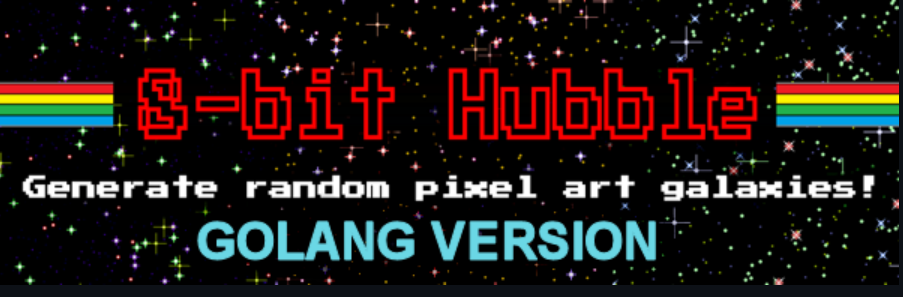
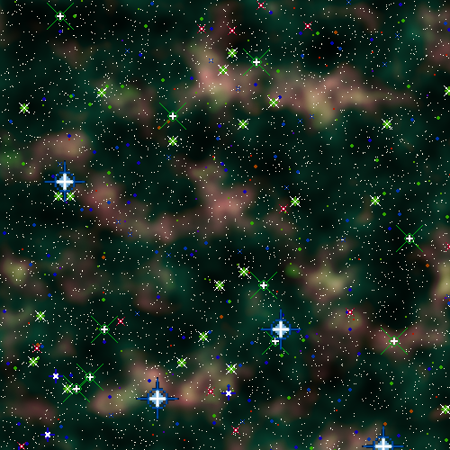
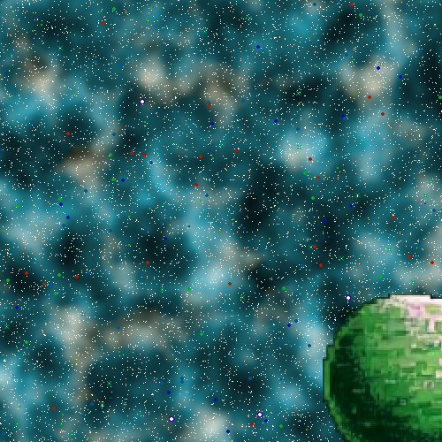
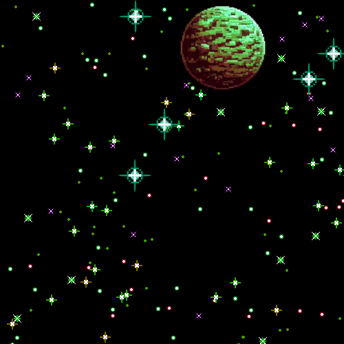
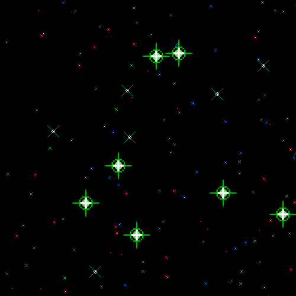
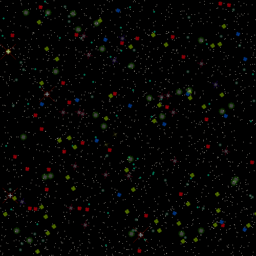

**8-bit Hubble (Go)** is a complete reimplementation—and ongoing **expansion**—of the original **[8-bit Hubble](https://github.com/amcajal/8_bit_hubble)**

For background on the tribute to Hubble, classic games, and the “Bob Ross” layering idea, see the [original project README](https://github.com/amcajal/8_bit_hubble) and [wiki](https://github.com/amcajal/8_bit_hubble/wiki).

---

## Overview

**8-bit Hubble** (Golang version) generates random **pixel-art galaxy** images (and WebP animations too), containing stars, nebulas, planets, etc. Goal: try to get random, cool-looking, SNES-alike images of our universe!

Example output:



---

## Quickstart

### Requirements

- [Go](https://go.dev/) 1.26+ (see [`go.mod`](go.mod))

### GUI

```bash
git clone https://github.com/amcajal/8_bit_hubble_golang.git
cd 8_bit_hubble_golang
go run ./cmd/gui
```

Fill in the output directory and image name, optionally set a seed and advanced flags, then **Generate Galaxy!**

### CLI

```bash
go run ./cmd/cli --help

# Default output: ./8bh_galaxy.png (seed = current time)
go run ./cmd/cli

# Reproducible run with custom path
go run ./cmd/cli -s 42 -o ./output -n my_galaxy

# Animated WebP with config overrides
go run ./cmd/cli -a -s 99 -n blinking_stars -c config_example.toml
```

Build standalone binaries:

```bash
go build -o 8bHubbleGolang ./cmd/cli
go build -o 8bHubbleGolang-gui ./cmd/gui
```

### Go library

```go
import "github.com/amcajal/8_bit_hubble_golang/galaxy"

img, err := galaxy.GenerateImage(galaxy.Config{
    Width: 1000, Height: 500, Seed: 42,
})
// err := galaxy.GenerateToFile(galaxy.Config{ ... OutputDir, OutputFileName, ... })
```

Implementation details live under `internal/`; only `galaxy` is the supported import path for other modules.

---

## Dependencies — bild_modfor8bhg

Image processing (noise generation, blending, colour adjustment) is handled by **[bild_modfor8bhg](https://github.com/amcajal/bild_modfor8bhg)**, a custom fork of the [anthonynsimon/bild](https://github.com/anthonynsimon/bild) library.

The fork was created to solve a **determinism requirement**: the upstream library initialised its own internal random sources independently, so Perlin noise and binary noise outputs were non-reproducible even when the same seed was provided to 8-bit Hubble. The fork fixes that.

---

## License

**8-bit Hubble** was created by Alberto Martin Cajal. This Go reimplementation and extension is released under **GNU GPL v3.0**—see [`LICENSE`](LICENSE) and the [GPL text](https://www.gnu.org/licenses/gpl-3.0.en.html).

Third-party Go modules (Gio, TOML parser, bild, nativewebp, etc.) are used under their respective licenses; see module sources and `go.mod`.

---

## Contact

Original author contact details: [8_bit_hubble README — Contact](https://github.com/amcajal/8_bit_hubble#contact).
